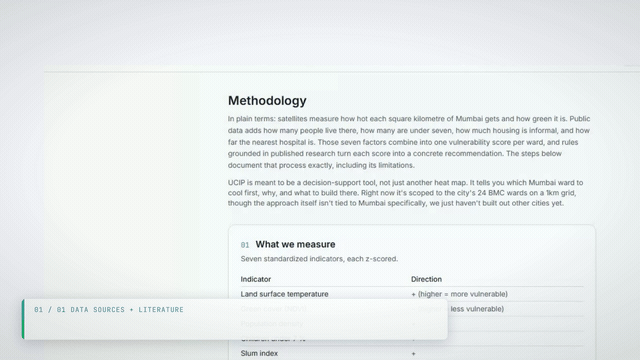

<div align="center">


**Ward-level heat vulnerability for Mumbai, built only from free, open data.**

[](https://doi.org/10.5281/zenodo.22923919)
[](LICENSE)


**[Open the live dashboard](https://uciplatform.vercel.app/dashboard)**

</div>

---

UCIP scores each of Mumbai's 24 BMC wards for heat vulnerability on a 0 to 100 scale, explains each score factor by factor, and suggests cooling interventions that pass an ecological check. Every scored input comes from free, open, global data, so the same pipeline can be pointed at another city.

It is a citable, versioned dataset with a dashboard and an API. It is not a forecast and not a warning service: for heatwave warnings, use the [India Meteorological Department](https://mausam.imd.gov.in/).

<div align="center">

</div>

## What goes into the score

Mumbai is cut into 1 km cells (541 of them with people living in them). Each cell gets five measurements:

| Factor | What it measures | Source | Licence |
|---|---|---|---|
| Land surface temperature | How hot the ground gets on dry-season afternoons | Landsat 8/9 Collection 2 | public domain |
| Green cover (NDVI) | How much vegetation there is (more green, less vulnerable) | Landsat 8/9 Collection 2 | public domain |
| Population density | How many people live in the cell | WorldPop 2020, 100 m | CC BY 4.0 |
| Hospital distance | How far the cell centre is from the nearest hospital | OpenStreetMap | ODbL |
| Impervious share | How much of the cell is paved or built up | ESA WorldCover 2021, 10 m | CC BY 4.0 |

Each factor is standardised, and the weights are the first principal component of Mumbai's own cells, following the method of Reid et al. 2009. If that component explains less than 30% of the variance, the pipeline falls back to equal weights and says so. The weighted sum is rescaled to 0 to 100 and averaged up to wards.

Because the index is a plain weighted sum, every ward's score splits exactly into the five contributions. The dashboard shows that split, so you can see whether a ward is high because of heat, crowding, paving or distance to care.

Two Mumbai-only inputs used to be scored and no longer are: the slum share (one-off Datameet polygons) and the under-7 share (Census 2011 ward tables). Neither exists for most cities or gets updated, so both were taken out of the index on 2026-10-17. They are still published per cell as context.

## What you can do with it

<div align="center">

</div>

- **Find a ward.** Click it on the map, search the ward list (desktop), or use "find my ward" with your location.
- **Read the breakdown.** Each ward shows its score, rank, the contribution of each factor, its neighbours, and the interventions its cells qualify for.
- **Switch layers.** Four map layers: the ward score, the same score per 1 km cell, plantability (where trees make ecological sense and where cool roofs are the better fix), and green-cover change since the 2016-17 dry season.
- **Compare wards.** Star up to four and open them side by side. The selection lives in the URL, so it can be shared.
- **Print or embed.** Each ward has a printable brief and an embeddable card at `/embed/ward/{slug}`, where the slug replaces the slash in a split ward's code (`F/N` becomes `F-N`).
- **Try a what-if.** The [simulator](https://uciplatform.vercel.app/simulate) gives a first-order estimate of daytime cooling from more tree canopy, higher roof albedo or pocket parks, plus one worked budget scenario in rupees.

### How interventions are chosen

A small rule set maps each cell's measurements to candidates: rain gardens, cool roofs with shaded cooling centres, pocket parks, and native trees. Before trees are suggested, a plantability filter removes native grassland, wetland, mangrove, water and heavily sealed cells, following the restoration literature (Bastin et al. 2019, with the grassland caution of Veldman et al. 2019). In Mumbai the tree rule currently fires on no cell, because every hot, bare cell is already built up. Some rule thresholds are our own judgement rather than a paper's; the methodology page names them.

## How sure is it

<div align="center">

</div>

The [methodology page](https://uciplatform.vercel.app/methodology) computes these from the pipeline's own output files:

- **Rank uncertainty.** A bootstrap over the cells gives each ward a plausible rank range. Most ranges span several places, so the exact order should not be quoted on its own.
- **Weight sensitivity.** Each weight is moved up and down by 20% and the ranking is compared with the baseline.
- **Weighting choice.** The PCA weights are compared with equal weights.
- **Ground check.** The satellite temperature layer is correlated with two NOAA weather stations (Santacruz and Colaba). It tracks day-to-day variation (pooled r = 0.716), but surface temperature is not air temperature, and the check uses an earlier dry season than the index because station data is published with a lag.

### Known limits

- Daytime surface temperature only. There is no night-time data, and night heat is what harms people most.
- Informal housing and age are not scored, so wards with large informal populations may rank lower than their real vulnerability.
- Hospital distance runs against the other four factors on the principal component (hot, dense cells sit close to hospitals). The index keeps the literature's direction for it. This is an open question.
- Population is a WorldPop 2020 model, not a census count.
- The boundary file has 24 wards. BMC has since opened K North (split from K/E) and reportedly split P North; those are not reflected.
- The cooling coefficients come from studies in other cities and are not calibrated for Mumbai.

## Run it locally

```bash
git clone https://github.com/AnayDhawan/UCIP.git
cd UCIP/frontend
npm install
npm run dev
```

Opens at `localhost:3000`. The API reads Supabase when it is configured and falls back to the committed snapshots in `frontend/public/` when it is not, so browsing needs no credentials.

Rebuilding the data needs Python 3, a Google Earth Engine project registered for noncommercial use, and the packages in `pipeline/requirements.txt`. See [CONTRIBUTING.md](CONTRIBUTING.md) and [pipeline/README.md](pipeline/README.md).

## The pipeline

Sixteen scripts under `pipeline/`, `00_gee_spike.py` (a connectivity check, skipped by default) through `15_optimize.py`, run in order by `run_pipeline.py`:

| Stages | What they do |
|---|---|
| 01-04 | Build the 1 km grid, pull Landsat, WorldCover, WorldPop and OSM, and tidy one row per cell |
| 05 | Standardise, weight by PCA, score, roll up to wards |
| 06 | Plantability filter and intervention rules |
| 07 | Write the published snapshots, and load the database when credentials are set |
| 08-13 | Sensitivity, green-cover change, ward profiles, landing-page models, ground-station check |
| 14 | Year-by-year ward temperature and NDVI trend (only with `--include-annual`) |
| 15 | The worked budget scenario |

A scheduled workflow re-runs the full pipeline twice a week and checks the output against plausibility bounds and the last published data. The stages that pull population and hospital data fail, rather than warn, when either comes back empty, and they check before writing, so a bad run leaves the last good data in place. The date of the data and the satellite window it came from appear in the dashboard footer and in `/api/v1/meta`.

## API

Read-only, no key, open CORS. **Base:** `https://uciplatform.vercel.app/api/v1`

| Endpoint | Returns |
|---|---|
| `GET /meta` | Coverage, counts, weighting method, licence, data date and satellite window |
| `GET /wards?limit=&geometry=` | Wards ranked most vulnerable first, with per-factor contributions |
| `GET /wards/{ward}` | One ward and its recommendations. `{ward}` is `L`, `F%2FN` or `F-N` |
| `GET /recommendations?ward=&limit=` | Interventions with rationale and citation |
| `GET /cells?ward=&bbox=&limit=&geometry=` | The 1 km cells behind the scores |
| `GET /lookup?lat=&lon=` | Which ward contains a point |
| `GET /export?dataset=cells\|wards&format=geojson\|csv` | The whole dataset in one request |
| `GET /openapi.json` | OpenAPI 3.1 spec |

```bash
curl 'https://uciplatform.vercel.app/api/v1/lookup?lat=19.076&lon=72.877'
curl 'https://uciplatform.vercel.app/api/v1/wards?limit=3'
curl 'https://uciplatform.vercel.app/api/v1/recommendations?ward=L'
curl 'https://uciplatform.vercel.app/api/v1/export?dataset=wards&format=csv'
```

A per-IP rate limit applies when the deployment has its rate-limit store configured. Full reference and versioning policy: [docs/api.md](docs/api.md). A Python client is on PyPI (`pip install ucip`); a TypeScript client and an MCP server are in `clients/` and `mcp-server/` but not yet published.

## Another city

The pipeline reads its city from `config/cities/<slug>.json`, validated against a schema in CI, and `pipeline/new_city.py` scaffolds one from a ward boundary file. Pune is configured as a test case. No second city has been run end to end yet, and the frontend still serves one city per deployment. [docs/adding-a-city.md](docs/adding-a-city.md) describes the current steps and what is still Mumbai-specific.

## Documentation

| Document | Covers |
|---|---|
| [docs/methodology.md](docs/methodology.md) | Indicators, weighting, rules, plantability filter |
| [docs/HVI-methodology-report.md](docs/HVI-methodology-report.md) | The full technical report with every computed result |
| [docs/DATA-DICTIONARY.md](docs/DATA-DICTIONARY.md) | Every published column: unit, range, source, derivation |
| [docs/references.md](docs/references.md) | The papers and datasets behind each choice |
| [docs/api.md](docs/api.md) | API reference, versioning and changelog |
| [docs/adding-a-city.md](docs/adding-a-city.md) | Running the pipeline for another city |
| [docs/prior-art.md](docs/prior-art.md) | Five comparable tools and how UCIP differs from them |
| [docs/accessibility-audit.md](docs/accessibility-audit.md) | Automated accessibility audit results |

## Contributing

Bug reports, data questions and pull requests are welcome. Start with [CONTRIBUTING.md](CONTRIBUTING.md) and the [Code of Conduct](CODE_OF_CONDUCT.md). For anything else, [open an issue](https://github.com/AnayDhawan/UCIP/issues).

UCIP is a research project by a student. It is not an official BMC tool.

## Citation

```bibtex
@software{ucip,
  author = {Dhawan, Anay},
  title  = {UCIP: Urban Climate Intelligence Platform},
  doi    = {10.5281/zenodo.22923919},
  url    = {https://github.com/AnayDhawan/UCIP}
}
```

## License

Code: Apache 2.0, see [LICENSE](LICENSE). Each data source keeps its own licence, listed above and on the [legal page](https://uciplatform.vercel.app/legal).
